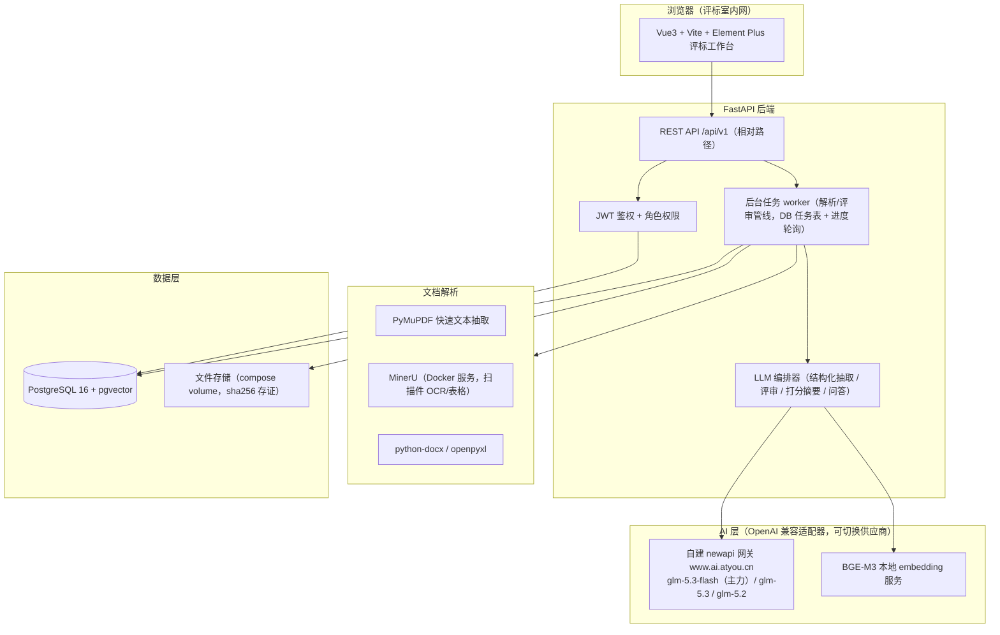

# 辅助评标智能体 PRD 与技术方案

> 版本：v0.1（方案稿）　|　日期：2026-09-17　|　状态：技术栈已确认，待评审
> 参考调研：见 `参考资料/README.md`（ai-pingbiao-demo、tender-ai、wzhnbb/bidding、MinerU 等）

---

## 0. 项目说明

### 0.1 一句话定位
面向**评标委员会**的「开标后辅助评标智能体」：解析招标文件形成结构化评审条目库，逐条对照各投标文件给出**带原文证据的三态结论**，辅助专家打分、问答、对比、清标与预警，最终汇编评标报告底稿。

### 0.2 边界（明确不做）
- **不做**电子招投标交易平台：报名、保证金、CA 数字证书、电子签章、远程开标、供应商门户。
- **不做**投标文件编制工具（标书生成器）。
- **不做**自动定标：AI 永远只产出「建议 + 证据」，最终结论由评标委员会作出。

### 0.3 已确认的技术决策（2026-09-17 问答）

| 决策项 | 结论 |
|---|---|
| 产品边界 | 专家辅助评标工作台（不开交易平台） |
| 一期功能 | 资格/符合性审查、评分办法辅助打分、专家问答与横向对比、报价清标与围标串标预警（四块全做） |
| 技术栈 | FastAPI + Vue3 + Docker Compose（对齐 d:\PL0qt\物料管理 agent/agent2） |
| 评分办法 | 以**综合评分法**为主，抽取模板按综合评分法优先设计 |
| 投标文件形态 | 含**工程电子标书专有格式**（见 5.3.1 处理策略） |
| 专家并发 | 单评审室人数峰值约 50（见 2.1/4 并发设计） |
| 外部对接 | 不对接现有交易平台/OA，文件纯手工上传 |
| 部署与模型 | 服务器内网部署；LLM 走自建网关 `https://www.ai.atyou.cn`（OpenAI 兼容，newapi），主力模型 **glm-5.3-flash**（备选 glm-5.3 / glm-5.2），已实测连通；**网关无 embedding 模型** → 向量化本地跑 BGE-M3 |
| 保密 | 投标文件**允许**送云端 LLM（甲方已确认） |

---

## 1. 产品概述

### 1.1 核心价值
- **提效**：评审条目自动对照、证据自动定位，专家从「翻几千页 PDF 找依据」变为「逐条确认 AI 给出的证据与建议」。
- **防漏**：否决项/资格项逐条过检，不漏审、不错审；不确定的一律标记「待复核」而不是放行。
- **留痕**：每次打分、修改、查看均有日志；每条结论可回溯到投标文件原文页码，满足评标报告与事后检查要求。
- **防串**：文件层围标串标特征自动预警（相似度、元数据、报价规律），给专家提供独立视角。

### 1.2 合规红线（设计原则，依据《招标投标法》及其实施条例、《电子招标投标办法》）
1. 评标主体是评标委员会，系统定位是**辅助工具**，AI 不自动否决、不自动定标。
2. 否决/不通过结论必须引用招标文件明确条款；抽取不清或证据不足 → 一律「待复核」，不得机器否决。
3. 专家独立评审：**汇总前专家之间分数与意见互相不可见**。
4. 全程留痕：操作日志 append-only，评标结束后可导出完整过程档案。
5. 投标文件上传后 sha256 存证、只读，防篡改。

### 1.3 名词解释
| 术语 | 说明 |
|---|---|
| 评审条目 | 从招标文件中结构化抽出的单条要求：资格条件 / 符合性（否决）项 / 评分项 |
| 三态结论 | 每条评审结论只有三种：`通过` / `不通过` / `待复核`（默认态） |
| 清标 | 开标后对投标报价进行算术核对、符合性核对、不平衡报价识别 |
| 围标串标预警 | 基于投标文件本身特征（相似度、元数据、报价规律）的异常提示 |
| 评分办法 | 招标文件中的评分标准：权重、分值、评分细则（客观分/主观分） |

---

## 2. 用户与场景

### 2.1 角色
| 角色 | 诉求 | 权限 |
|---|---|---|
| 评标专家 | 快速逐条审查、定位证据、打分留痕 | 本人负责项目的评审与打分；互不可见他人结果 |
| 评标组长 | 组织评审、汇总分数、出报告 | 汇总视图 + 全部专家结果（仅汇总阶段）+ 报告导出 |
| 项目管理员（招标代理/采购人侧） | 建项目、传文件、维护专家名单 | 项目与文件管理、评审条目库确认、不开分 |
| 监督/观察员 | 全程留痕查看 | 只读 + 审计日志 |

**并发规模**：已确认单评审室专家数峰值约 **50**（大项目分组评审）。设计含义：
- 评分页、审查工作台按「分组 + 分包件」拆分任务，50 人不能都挤同一份打分表（评分办法前附表通常按包件/专业分组）。
- 打分保存走幂等 PUT + 乐观锁，避免同条目并发覆盖；50 并发写入 PostgreSQL 无压力。
- 解析/评审生成任务串行进队列、worker 池化消费，峰值上传不冲垮 LLM 网关限速。

### 2.2 核心场景：开标后的评标会
1. **准备**（会前/会上）：管理员建项目，上传招标文件（+ 评分办法、控制价）；系统解析生成评审条目库，专家/组长确认修订。
2. **上传投标**：上传各家投标文件（PDF/Word/Excel，一投标人一包多文件），后台解析入库。
3. **审查**：系统逐条对照，专家逐条确认「通过/不通过/待复核」，可点开原文定位。
4. **评分**：客观分自动建议，主观分给证据摘要与参考区间，专家独立打分。
5. **问答/对比**：评审中有疑问随时问（带引文回答）；横向对比各家响应情况。
6. **清标/预警**：报价表上传后自动算术核对；围标预警卡片供专家参考。
7. **汇总报告**：组长汇总 → 生成评标报告底稿（Word/Excel）→ 导出留档。

---

## 3. 功能需求（一期全量四模块）

### 3.1 项目与文件管理
- 项目 CRUD：名称、类型（货物/工程/服务）、评标办法类型、控制价、评标时间。
- 招标文件上传（多文件），投标人档案（名称、包件号）+ 投标文件上传（一投标人多文件，支持 100MB 级 PDF）。
- 解析任务异步执行 + 进度轮询（沿用 agent「导入 ERP 数据」的后台任务+轮询模式，**不在请求路径里同步调 LLM**）。
- 文件指纹（sha256）与解析状态（待解析/解析中/成功/失败需人工）。

**验收**：100MB PDF 上传解析不出错；扫描件走 OCR 通路；失败可重试。

### 3.2 招标文件智能解析（评审条目库）
- 自动章节定位：评标办法前附表、资格审查条件、符合性（否决）条款、评分细则、技术/商务要求。
- 条目抽取（LLM 结构化输出，带**原文引用 + 页码**）：
  - 资格条件项：类型（证照/业绩/财务/人员…）、要求值、证明材料。
  - 符合性/否决项：条款原文、判定要点。
  - 评分项：分值、评分标准原文、客观/主观分类、证明材料要求。
- **专家确认界面**：条目树逐条确认/修改/增删——AI 抽取结果经专家确认后才成为评审依据（人工在环是硬要求）。
- 支持手工录入/Excel 导入条目作为兜底。

**验收**：一份典型综合评分法招标文件，资格/符合性/评分项抽取召回 ≥80%（抽样人工核对），条目编辑保存生效。

### 3.3 资格与符合性审查
- 对每个投标人 × 每条资格/符合性条目：混合检索该投标人文件证据 → LLM 判读 → 三态结论 + 证据引用（页码 + 原文片段）+ 置信度。
- 客观比较（数值/日期/有无）用确定性规则校验 LLM 结论；**缺证据 → 待复核，不自动不通过**。
- 专家逐条确认终值；「不通过」必须填否决理由（引用条款），进报告。
- 汇总视图：条目 × 投标人矩阵。

**验收**：结论 100% 带证据引用或标「待复核」；无证据自动否决 = 0 次。

### 3.4 评分办法辅助打分
- 客观分：按条目审查结果自动计算建议分（如业绩每满 1 个得 2 分，封顶 6）。
- 主观分：定位投标文件相关章节 → LLM 生成评分要点摘要（优点/风险/对应细则）+ 参考分区间；专家打分并填打分理由。
- 专家间**分数隔离**：打分页只显示本人；组长在汇总页可见全部。
- 改分留痕：每次修改记录前后值 + 时间 + 理由。
- 分值合法性校验：不得超项分值、必填理由规则可配。

**验收**：两位专家互不可见分数；改分有完整历史；报告汇总分数与明细一致。

### 3.5 专家问答与横向对比
- 问答：针对某投标人或全部，混合检索（向量 + 关键词）+ LLM 生成，回答**强制带引文卡片**（文件名/页码/原文），评分场景预设问题（如「该投标人近三年类似业绩有哪些？是否满足年限要求？」）。
- 问答记录留痕、可回看，作为评审过程档案一部分。
- 横向对比：条目 × 投标人响应矩阵、评分对比表、雷达/柱状图（图表响应**不得同步等待 LLM**）。

**验收**：问答引用的页码可点开定位到原文块；无相关内容时明确说「未找到」并建议复核，不编造。

### 3.6 报价清标与围标串标预警
**清标**（上传报价明细 Excel/PDF 表格）：
- 算术核对：单价 × 数量 = 合价、分项合计 = 总价、大小写金额一致。
- 与招标控制价/最高限价比较：超限价预警。
- 漏项检测：与招标工程量/供货清单对照（一期能对 Excel 清单，工程专有 XML/GXB 格式放二期）。
- 不平衡报价识别：单价相对基准离散 + 数量加权的异常项清单。

**围标串标预警**（文件层特征，无需交易平台数据）：
- 文档元数据：创建/修改时间簇集、作者/单位字段重合、生成软件一致。
- 文本相似度：分段 simhash/minhash 相似、相同错别字/错误、条款复制。
- 报价规律：总价等差/等比、固定比例关系。
- 输出预警卡片（级别 高/中/低 + 证据），**仅供专家参考**，不进否决结论。

**验收**：构造的两份雷同标书能被相似度+元数据双通道命中；算术错误全部检出。

### 3.7 评标报告与全程留痕
- 评标报告底稿一键生成（python-docx → Word）：项目信息、审查汇总、评分汇总、否决/预警说明、专家签字栏。
- 明细导出 Excel（条目级结论 + 证据页码）。
- 审计日志：登录、查看、打分、修改、导出全部 append-only 记录；支持按项目导出过程档案。

---

## 4. 非功能需求
| 项 | 要求 |
|---|---|
| 并发 | 单评标室 5~9 名专家同时评审不卡顿；解析任务后台化不阻塞页面 |
| 性能 | 页面交互（除解析/评审生成）< 1s；单投标人全条目审查生成 ≤ 5 分钟（异步、可看进度） |
| 数据量 | 单项目投标文件 ≤ 3GB；单 PDF ≤ 500 页正常解析 |
| 可用性 | 解析/评审失败可重试，条目数据不丢 |
| 浏览器 | Chrome/Edge 现代版本 |

---

## 5. 技术方案

### 5.1 总体架构


### 5.2 技术栈清单
| 层 | 选型 | 说明 |
|---|---|---|
| 后端 | Python 3.12 + FastAPI + uvicorn + pydantic v2 | 与现有 agent/agent2 同构 |
| 前端 | Vue3 + Vite + Element Plus + ECharts | 生产构建进 nginx 镜像（吸取改 nginx 必 rebuild 的教训） |
| 数据库 | PostgreSQL 16 + pgvector | JSONB 存解析结果/证据，向量检索问答 |
| 任务 | DB 任务表 + 后台 worker（asyncio） | 一期不引 Redis/Celery，降低运维面；二期可平滑替换 |
| PDF 解析 | PyMuPDF（文字版快速路径）+ MinerU Docker（扫描件/复杂表格） | MinerU 按需启停，CPU 可跑、慢但可用 |
| Office | python-docx、openpyxl | Word 读取、报价表、报告导出 |
| LLM | 自建 newapi 网关 `https://www.ai.atyou.cn`（OpenAI 兼容）：主力 **glm-5.3-flash**，难例升级 glm-5.3 / glm-5.2（已实测连通，支持 JSON 输出） | env 配 BASE_URL/KEY/MODEL，适配器可切通义/DeepSeek/内网 vLLM |
| Embedding | **BGE-M3 本地服务**（CPU 可跑）或 BGE-m3 via sentence-transformers 容器 | 网关无 embedding 模型（已实测 model_not_found），故本地向量化 |
| 部署 | Docker Compose 单机（内网服务器） | web/nginx + api + worker + postgres + mineru + bge-embedding |
| 鉴权 | JWT + 角色（admin/组长/专家/观察） | 简单账号体系，不对接 SSO（如需放二期） |

### 5.3 文档解析管线
1. **快速路径**：PyMuPDF 逐页抽文本（电子版 PDF 绝大多数直接可用）。
2. **OCR 路径**：页字符密度低于阈值 → 该页转图送 MinerU 兜底，保留页码对齐。
3. **Office**：python-docx / openpyxl 抽文本与表格，段落号当页码近似。
4. **工程电子标书专有格式**（已确认存在）：一期不做内容级解析，降级策略——① 按 ZIP 容器结构解包，抽取其中可读的 PDF/XML 成员走正常管线；② 解不出可读内容则标「专有格式需人工」，专家在条目确认页可手工录入该投标人的响应值兜底。GXB 等格式的内容级解析列入二期（需样例文件逆向）。
5. **统一产物**：`pages[{page_no, text, tables[]}]` → 按语义分段切块（带 doc_id/page_no/section 路径）→ 入 PostgreSQL（正文 + embedding）。
6. 解析产物缓存：同 sha256 不重复解析。

### 5.4 LLM 编排与评审管线
- **抽取**（招标文件 → 条目库）：先规则定位「评标办法/资格条件」章节（关键词+目录结构），仅把相关章节送 LLM 结构化抽取（JSON Schema 强约束），避免整文塞 prompt；长文档分片抽取后合并去重。
- **审查**（条目 × 投标人）：混合检索（pgvector 向量 + PostgreSQL 全文/关键词）top-k 证据 → LLM 按条目判定，输出三态 + 引用 + 置信度 → **确定性校验器**复核数值/日期/有无类结论 → 低置信度强制「待复核」。
- **打分摘要**：主观分项先检索再摘要，参考区间由评分细则文本推导，只给建议不落最终分。
- **问答**：检索增强 + 强制引文输出；「未找到」是合法回答。
- **统一规范**：所有 LLM 调用走一个 `llm_client`（重试/超时/温度 0~0.2/JSON schema 校验）；每次调用记录 token 用量与耗时进审计表（成本可算）。

### 5.5 数据模型（主要表）
| 表 | 关键字段 |
|---|---|
| users / roles | 账号、角色、所属项目授权 |
| projects | 名称、类型、办法类型、控制价、状态 |
| documents | project_id、bidder_id(可空=招标文件)、文件名、sha256、页数、解析状态 |
| doc_chunks | document_id、page_no、section_path、text、embedding vector |
| requirement_items | project_id、类型(资格/符合性/评分)、条款原文、要求值、分值、来源页码、专家确认状态、确认人 |
| review_results | item_id、bidder_id、ai_state(三态)、ai_evidence(JSON: 引文+页码)、ai_confidence、expert_state、expert_evidence、modifier 历史 |
| scores | item_id、bidder_id、expert_id、score、comment、历史 |
| price_items / clearing_results | 报价明细、算术核对结果、异常项 |
| alerts | 类型(围标/清标)、级别、证据 JSON、涉及的投标人 |
| qa_messages | project_id、expert_id、问题、回答、引用 JSON |
| jobs | 任务类型、参数、进度、状态、错误 |
| audit_logs | who、when、action、target、detail（append-only） |

### 5.6 API 概览（/api/v1）
| 组 | 端点（示意） |
|---|---|
| 项目 | `POST/GET /projects`、`POST /projects/{id}/experts` |
| 文件 | `POST /projects/{id}/documents`（上传）、`GET /jobs/{id}`（进度轮询） |
| 条目库 | `POST /projects/{id}/tender/parse`、`GET/PATCH /requirement-items`（确认/修订） |
| 审查 | `POST /projects/{id}/review/run`（按投标人）、`GET /review/results?bidder=`、`PATCH /review/results/{id}`（专家终值） |
| 评分 | `GET /score/sheet?bidder=`（仅本人）、`PUT /score`、`GET /score/summary`（组长） |
| 问答 | `POST /qa/ask`、`GET /qa/history` |
| 对比 | `GET /compare/matrix`、`GET /compare/scores` |
| 清标/预警 | `POST /clearing/upload`、`GET /clearing/results`、`GET /alerts` |
| 报告 | `POST /report/generate`、`GET /report/export.docx|xlsx` |
| 审计 | `GET /audit-logs`（管理员/监督） |

### 5.7 前端页面
| 页面 | 要点 |
|---|---|
| 项目工作台 | 项目卡片、状态、进入评审 |
| 条目库确认页 | 条目树（资格/符合性/评分分页签）、原文引用展开、编辑确认 |
| 审查工作台 | 左条目列表（状态色标）/ 右投标文件定位预览（页码跳转） |
| 评分页 | 打分表（本人）、AI 建议列、证据摘要、理由输入、进度保存 |
| 问答页 | 对话式 + 引文卡片 + 定位跳转 |
| 对比页 | 响应矩阵 + 评分对比图表（不等待 LLM） |
| 清标/预警页 | 报价表上传、核对结果表、预警卡片 |
| 汇总报告页 | 组长专属：分数汇总、否决清单、报告生成导出 |
| 审计页 | 监督/管理员查看日志 |

### 5.8 部署形态
- 内网单服务器 Docker Compose：`nginx(frontend) + api + worker + postgres + mineru(按需)`。
- 仅 LLM/embedding API 走出网（经代理白名单）；所有业务数据不落地外部。
- 沿用物料管理经验：前端 API 全部相对路径 `/api/v1`；改前端必须 `--build` 重建镜像；无 Redis 依赖。

---

## 6. 里程碑计划（1 名开发 + Claude Code 协作，弹性估算）

| 阶段 | 内容 | 工期 |
|---|---|---|
| M0 骨架 | compose、鉴权角色、项目/文件管理、上传与解析任务框架 | ~3 天 |
| M1 解析 | 解析管线（PyMuPDF+MinerU+Office）、条目抽取、条目库确认页 | ~1.5 周 |
| M2 审查+评分（核心） | 评审管线、审查工作台、三态结论、评分页与隔离 | ~2 周 |
| M3 问答+对比 | RAG 问答带引文、对比矩阵与图表 | ~1 周 |
| M4 清标+预警+报告 | 报价核对、围标预警、报告导出、审计完善 | ~2 周 |
| M5 试评调优 | 真实招标文件建回归评测集（抽取召回、审查命中率、引用准确率），按指标调 prompt/检索 | 持续 |

合计约 **7~8 周** 出一版可用于真实评标辅助的系统。

## 7. 风险与对策
| 风险 | 对策 |
|---|---|
| ~~投标文件出域到云端 LLM 的保密合规~~ | **已解决（2026-09-17 甲方确认允许送云端 LLM）**；LLM 走自建 newapi 网关，密钥 env 注入不落码 |
| 评分办法千差万别，抽取不准 | 条目模板 + 专家确认在环 + 手工兜底；已确认综合评分法为主，按其优先设计模板 |
| 扫描件质量差 | MinerU 兜底；仍失败转「需人工」状态，不阻塞评审 |
| LLM 幻觉/漏检 | 强制引文、三态默认待复核、确定性规则二次校验、低置信度降级 |
| 大文件与长文本 | 分片抽取 + 检索问答，绝不整文塞 prompt；解析缓存按 sha256 |
| 工程电子标书专有格式（GXB/XML） | 一期 ZIP 解包 + 人工录入兜底（见 5.3 第 4 条）；内容级解析需拿到样例文件，列入二期 |
| glm-5.3-flash 网关稳定性（首次调用曾 upstream error，重试即恢复） | llm_client 统一重试 3 次递增间隔 + 模型降级链 flash→5.3→5.2；关键任务失败转待复核不阻塞 |
| 单室 50 专家并发 | 分组/分包件拆分打分任务、乐观锁防覆盖、worker 池化控 LLM 限速（见 2.1） |

## 9. 实施记录（as-built）

### M0 骨架（2026-09-17 完成）
四角色 JWT（admin/leader/expert/observer）、项目/成员/投标人/文档管理、sha256 内容寻址上传去重、DB 任务表 + worker（FOR UPDATE SKIP LOCKED）、审计日志 append-only、项目内成员权限（非成员一律 403）。

### M1 条目库（2026-09-17 完成）
关键词定位评审热点页（±1 邻页）→ 3200 字分片（带页码标记）→ glm-5.3-flash 结构化抽取三类条目 → 相似度去重（>0.8 视为同条）→ **人工在环确认**（手工录入视为已确认）。样例招标文件抽取 18 条，页码全部准确。

### M2 审查与评分（2026-09-18 完成）
| 组件 | 实现要点 |
|---|---|
| 证据检索 | **中文无分词的字符 2-4gram TF-IDF**（IDF 由分块语料现算 + 数值命中加权）。M3 接 pgvector 后在此叠加向量分即可，接口不变 |
| 三态判定 | LLM 判定 passed/failed/review + 证据页码，prompt 明确「仅未检索到不得判 failed」 |
| 确定性校验器 | R1 无证据→待复核；R2 判不通过但无引用页→待复核；R3 置信度<0.6→待复核；R4 数值门槛复核（下限：至少 N 个/不足 N 日；上限：超过 N 万元），带邻近关键词门控避免注册资本等误判；**只做保守降级，绝不把 failed/review 提升为 passed** |
| 评分建议 | 评分项输出要点摘要 + 建议分与区间，仅建议不落最终分 |
| 打分与隔离 | 打分表只返回本人分数（后端强制）；汇总视图仅组长/admin；改分写 score_history（前后值+理由）+ 审计 |
| 原文定位 | 10 分钟有效、绑定 document_id 的查看短令牌 → 浏览器内置 PDF 阅读器 `#page=N` 定位（iframe 无法带 Authorization 头） |
| 工程化 | 上传文件挂 **named volume**（此前存容器内，重建即丢）；服务重启自动把 running 任务重排为 pending；nginx 动态 resolver（容器重建不再 502） |

**关键坑（已记入记忆）**：PyMuPDF 生成中文 PDF 必须用 `fontname="china-s"`，否则中文变 `0xb7` 乱码点 —— 表现为抽取 0 条且无报错，排查需读 codepoints。测试样例生成见 `scripts/m2_e2e.py`。

## 8. 待确认问题（2026-09-17 已全部确认）

| # | 问题 | 结论 |
|---|---|---|
| 1 | 评分办法类型 | **综合评分法为主** |
| 2 | 投标文件形态 | **含工程电子标书专有格式** |
| 3 | 专家并发规模 | **单室峰值约 50 人**（同时评审项目数未单独确认，按 2~3 个并行设计） |
| 4 | 交易平台/OA 对接 | **不需要，纯手工上传** |
| 5 | LLM 供应商 | 自建网关 `https://www.ai.atyou.cn`，key 由用户会话提供（不落盘仓库），模型 **glm-5.3-flash**（已实测可用；网关无 embedding 模型，向量化本地 BGE-M3） |
| 6 | 保密等级 | **投标文件允许送云端 LLM** |

## 9. 实施记录（as-built）

### M0 骨架（2026-09-17 完成）
四角色 JWT（admin/leader/expert/observer）、项目/成员/投标人/文档管理、sha256 内容寻址上传去重、DB 任务表 + worker（FOR UPDATE SKIP LOCKED）、审计日志 append-only、项目内成员权限（非成员一律 403）。

### M1 条目库（2026-09-17 完成）
关键词定位评审热点页（±1 邻页）→ 3200 字分片（带页码标记）→ glm-5.3-flash 结构化抽取三类条目 → 相似度去重（>0.8 视为同条）→ **人工在环确认**（手工录入视为已确认）。样例招标文件抽取 18 条，页码全部准确。

### M2 审查与评分（2026-09-18 完成）
| 组件 | 实现要点 |
|---|---|
| 证据检索 | **中文无分词的字符 2-4gram TF-IDF**（IDF 由分块语料现算 + 数值命中加权）。M3 接 pgvector 后在此叠加向量分即可，接口不变 |
| 三态判定 | LLM 判定 passed/failed/review + 证据页码，prompt 明确「仅未检索到不得判 failed」 |
| 确定性校验器 | R1 无证据→待复核；R2 判不通过但无引用页→待复核；R3 置信度<0.6→待复核；R4 数值门槛复核（下限：至少 N 个/不足 N 日；上限：超过 N 万元），带邻近关键词门控避免注册资本等误判；**只做保守降级，绝不把 failed/review 提升为 passed** |
| 评分建议 | 评分项输出要点摘要 + 建议分与区间，仅建议不落最终分 |
| 打分与隔离 | 打分表只返回本人分数（后端强制）；汇总视图仅组长/admin；改分写 score_history（前后值+理由）+ 审计 |
| 原文定位 | 10 分钟有效、绑定 document_id 的查看短令牌 → 浏览器内置 PDF 阅读器 `#page=N` 定位（iframe 无法带 Authorization 头） |
| 工程化 | 上传文件挂 **named volume**（此前存容器内，重建即丢）；服务重启自动把 running 任务重排为 pending；nginx 动态 resolver（容器重建不再 502） |

**关键坑（已记入记忆）**：PyMuPDF 生成中文 PDF 必须用 `fontname="china-s"`，否则中文变 `0xb7` 乱码点 —— 表现为抽取 0 条且无报错，排查需读 codepoints。测试样例生成见 `scripts/m2_e2e.py`。

**M2 实测（3 家投标人 × 17 条，构造样例：甲完全合规 / 乙业绩不足+有效期 60 日 / 丙报价超限价）**：

| 投标人 | 通过 | 不通过 | 待复核 | 说明 |
|---|---|---|---|---|
| 甲（合规） | 9 | **0** | 4 | 无假阳性；4 条待复核均因材料未含证据（失信查询、文件组成等），符合"无证据不得判通过" |
| 乙（业绩 1 个、有效期 60 日） | 5 | **3** | 5 | 校验器独立命中：`R4_min_个_2_evidence_max_1`、`R4_min_日_90_evidence_max_60` |
| 丙（报价 125 万 > 限价 118 万） | 3 | **1** | 9 | 报价条目判不通过；保证金未提交 → `R1_no_evidence` 转待复核（不自动否决） |

专家流程实测：判不通过不填理由 → 400 拒绝；超本项分值 → 400 拒绝；改分 32→28 留痕（previous 落库）；**打分隔离**（张专家所打分数李专家视角为 None）；专家访问汇总接口 403、组长可见均分与名单；原文定位短令牌（无令牌 401 / 带令牌 200 / 跨文档 401）。

LLM 用量（真实统计）：审查单条平均 6.9 秒，159 次调用合计约 5.4 万输入、7.8 万输出 token —— 一个 3 家投标人项目全量审查不到 10 万 token。

### 并发与文本处理的三个必修坑（M2 实测暴露）
1. **AsyncSession 不可并发**：条目并发审查时多个协程同时 `db.commit()` 写进度 → 轻则 `IllegalStateChangeError`，重则 greenlet 死锁挂死（表现为 job 长时间 running 但 LLM 调用停止）。修法：进度回写加 `asyncio.Lock` 串行化 + 百分比未变不写 + 失败只告警。
2. **PDF 抽取会把数字换行拆开**（"投标有效期为60日" → "6 / 0日"），数值校验会取到半个数（曾把 60 读成 0）。修法：`parser.join_split_digits` 在存块与送 LLM 前归一化。
3. **上传文件必须挂持久卷**：此前存容器 `/app/data`，任何一次容器重建都会丢标书（`up -d --build web` 也会连带重建 api）。

## 10. M3 实施记录（2026-09-18 完成）

### M3a 专家问答与横向对比
| 组件 | 实现要点 |
|---|---|
| 问答 | [qa.py](backend/app/qa.py)：按范围（全部/仅招标文件/指定投标人）取分块 → TF-IDF 检索 top10 → LLM 作答，**强制页码引文**；材料不足时必须回「材料中未找到相关内容」而不是编造（已实测：问「投标人甲的银行账号」正确回未找到）。问答全文留痕 `qa_messages`（评标过程档案） |
| 对比 | [api/qa.py](backend/app/api/qa.py)：条目 × 投标人响应矩阵（专家终值优先，委员会结论不隔离，成员可见）；评分对比含他人分数 → 仅组长/admin（实测专家访问 403） |
| 前端 | QaChat.vue（范围选择、预设问题、引文卡片点击跳原文）、Compare.vue（统计块 + 两张图 + 响应矩阵表 + 明细表） |

**图表规范**：用 dataviz 验证器实测配色——分类色（投标人身份）前三槽 ALL PASS；状态色仅用于通过/待复核/不通过并配文字标签；颜色按投标人 id 固定分配（跟实体不跟排名）；超 8 家折叠为「其他」；无双轴；表格视图始终存在。调色板集中在 [frontend/src/viz/palette.js](frontend/src/viz/palette.js)。

### M3b 评标报告导出
[report.py](backend/app/report.py) 汇编报告数据 → Word 底稿（表格式：项目情况 / 评审依据 / 审查矩阵 / 否决清单 / 待复核事项 / 评分汇总 / 签字栏）+ Excel 明细（3 个工作表：审查结论明细、不通过与待复核、评分汇总）。报告首行声明「系统辅助生成底稿，结论以评标委员会为准」；导出动作写审计日志；仅组长/admin 可导出（实测专家 403）。

### M3c 清标与围标串标预警
| 检查 | 实现 |
|---|---|
| 报价清单解析 | 上传 xlsx（doc_role=price）→ 表头模糊识别（列序不限）→ `price_items` 明细；合计行整行扫关键字识别，避免重复计入总额 |
| 算术核对 | 数量×单价≠合价（容差 0.01 或 0.1%）→ 高风险 |
| 超控制价 | 控制价按万元录入、报价表按元 → 自动识别口径（差 100 倍时按万元解读），含口径标注 |
| 不平衡报价 | 同条目单价高于各家同项中位数 1.5 倍 → 中风险，按数量排序 |
| 疑似漏项 | 多数投标人报了而个别未报的条目 |
| 文本相似度 | 字符 3-gram simhash + 汉明距离（≤10 高、≤18 中）；文本 <2000 字不做比较（短文本噪声大） |
| 文件元数据 | 作者/最后保存者相同 → 高；**软件默认值（openpyxl/WPS/Office 等）走停用词表不报**；生成时间 30 分钟内聚集 → 中；生成软件一致 → 低（弱信号明示） |
| 报价规律 | ≥2 家对同条目报完全相同单价（并注明其余家是否不同）；总价等差分布 |

**实测（构造样例）**：丙报价 125 万 > 控制价 120 万（超限价）✓；乙「300×620≠180000」（算术错误）✓；丙两处不平衡报价（轴承 1200 vs 中位 620）✓；甲/乙同报托辊单价 500 ✓；甲/乙无误报。所有结论标注「仅供专家参考，不构成否决依据」。

### 尚未做
**pgvector + BGE-M3 向量检索**：当前关键词 TF-IDF 检索效果已在问答/审查中验证可用；向量化需下载 BGE-M3（约 2GB）并加一个 CPU 推理服务，建议按真实标书的检索召回情况决定是否上（接口已预留：`retriever.retrieve` 叠加向量分即可）。

## 11. M4 实施记录（2026-09-18）

### 工程标书包（ZIP 容器）解包
[parser.py](backend/app/parser.py) 支持 zip 容器：递归解析成员中的 PDF/Word/Excel/XML/文本，二进制约章类成员跳过；含防 zip 炸弹上限（成员数 200 / 单成员 60MB / 总解压 200MB）；加密成员读取失败即跳过（容器整体加密时该文档转「需人工」）。**每页标注来源成员名**，证据卡片据此显示「来自哪个文件」；zip 容器的原文定位交给平台工具（浏览器无法按页渲染 zip），界面明确提示。

### 扫描件识别 + OCR 集成点
此前「有页但无文本层」的扫描件会被误标为「已解析」。现按页均字符判定（<20 字/页）→ 标为「需人工」并在界面说明原因。[ocr.py](backend/app/ocr.py) 提供真实集成点：默认关闭，启用后仅对无文本层页面调用（电子版页跳过），OCR 文本回填后自动重新分块进入检索管线。引擎选型见第 12 节。

### 并发能力：worker 独立进程
压测暴露瓶颈——任务 worker 与 API 同进程（M0 时的简化），长任务与请求争抢事件循环。改为 **compose 独立 worker 服务**（`python -m app.worker`）+ 连接池扩容（20/40）。

50 并发专家、30 秒实测（含后台并行跑一次完整审查作业）：

| 指标 | 内嵌 worker | 独立 worker |
|---|---|---|
| 吞吐 | 130.6 req/s | **196.3 req/s** |
| p50 | 91 ms | **43 ms** |
| p95 | 561 ms | **100 ms** |
| 错误 | 0 | **0**（4000+ 请求） |

### 评测集 harness（可量化回归）
[eval/](eval/) 放样例（标书文件 + `case.json` 标准答案，脚本生成以保证与文件不漂移），[scripts/eval.py](scripts/eval.py) 端到端跑一遍（建项目 → 上传 → 抽取 → 确认 → 审查）并给出指标报告（`eval/results/*.md|json`）。真实项目只需放文件与标准答案即可复用。

**合成样例基线**（14 条必备条目 / 9 项判定标准答案）：

| 指标 | 结果 |
|---|---|
| 条目抽取召回 | **100%**（14/14） |
| 来源页码准确（±1 页） | **100%** |
| 审查判定准确率 | **100%**（9/9） |
| 漏判（该否决未否决） | **0** |
| 误判（不该否决却否决） | **0** |
| 引文准确率（抽查） | **100%** |

实际抽取 18 条（多出的 4 条经核查均为招标文件中真实存在的其他条款：密封份数、标书构成、前附表保证金/有效期）——标准答案是「必备清单」而非穷尽清单。

### 检索能力评估与 embedding 决策（2026-09-18 实测）
用 [scripts/retrieval_probe.py](scripts/retrieval_probe.py) 测 recall@6，两组查询：

| 查询类型 | 纯关键词（字符 n-gram TF-IDF） | 加同义词扩展 |
|---|---|---|
| 系统内部措辞（条目原文，审查管线用） | **100%**（5/5） | 100% |
| 专家口语化提问（8 条自然提问） | **50%**（4/8） | **100%** |

口语化提问的关键词检索失败案例：`履约担保要交多少`（文档为「投标保证金」）、`标书要交几份`（文档为「正本一份副本四份」）、`公司准入要什么门槛`（文档为「资格要求」）——问答会回「未找到」，尽管答案在文件里。

**决策：暂不引入 embedding 模型**（BGE-M3 + pgvector，约 2GB 模型 + CPU 推理服务 + 入库全量向量化）。
改以 [synonyms.py](backend/app/synonyms.py) 领域同义词表做查询扩展（仅扩检索、送模型的问题保持原话），已上线并实测三问全部命中。
**局限与后续**：该表是按测试问题整理的起步版本，需按真实用语持续积累；问答已全量留痕（`qa_messages`），当同义词维护成本超过收益时再上向量检索——接口已预留（`retriever.retrieve` 叠加向量分，调用方不变）。

### 扫描件 OCR（PaddleOCR 系，独立服务）
[ocr_service/](ocr_service/) 为独立容器，按 compose profile 可选启动——主镜像保持精简、OCR 可单独下线：

```
docker compose -p pingbiao --profile ocr up -d ocr     # 启动 OCR 服务（本机 8800 便于自测）
OCR_ENABLED=true OCR_SERVICE_URL=http://ocr:8800       # .env 开启后重建 api/worker
```

**引擎实测结论（重要）**：镜像内同时装了 PaddleOCR 与 RapidOCR，服务启动时**在子进程里探测** PaddleOCR 是否可用，可用则用之，否则自动用 RapidOCR（同一套 PP-OCR 模型，ONNX 运行时）。本机实测 **PaddlePaddle 2.6.2 在容器内模型初始化即段错误**（退出码 -11），已排除 OMP 线程数、mkldnn、protobuf 版本三个常见诱因，故实际运行在 RapidOCR 上；`/health` 与每次识别响应都会报出实际引擎名，不隐瞒。若换到 PaddlePaddle 正常的主机，服务会自动切回 PaddleOCR，无需改代码。
（子进程探测是必需的：段错误会杀进程，Python 层 try/except 抓不住，直接 try 会导致服务崩溃重启循环。）

[backend/app/ocr.py](backend/app/ocr.py) 仅在文档「无文本层」时逐页渲染（200 DPI）调用 OCR，电子版页跳过；页级并发（`OCR_CONCURRENCY`）与服务端进程数（`OCR_WORKERS`）配套；**OCR 文本先做全角→半角归一**（识别常把 `108.00` 输出成 `108．00`，不归一会影响数值校验），回填后自动重新分块进入检索管线，失败则退回「需人工」不影响其余解析。

**实测（单页扫描件）**：识别 1.4~3.5 秒/页；内容准确（投标人甲 / 108.00万元 / 有效期90日 / 保证金2万元 均正确）；扫描件从「需人工」变为 `parsed`（`note: OCR 补回 133 字`），检索能命中该页并带出处。

## 12. M5 实施记录（2026-09-18）：真实招标文件实测

### 真实文件来源
政府采购网站（ccgp.gov.cn）本机不可达（403），省级交易中心不可达；百度搜索对非浏览器客户端返回验证码。最终通过可用搜索引擎检索到公开直链，取得**《政府采购货物类公开招标文件示范文本（试行）》91 页真实文件**（全文可提取，5.8 万字）。投标文件按法规不公开，故本轮只评估招标文件侧（`eval/cases/real1/`）。

### 抽取结果（真实文件）
| 指标 | 结果 |
|---|---|
| 解析 | 91 页 → 58,390 字 → 175 个检索分片 |
| 抽取命中分片 | 15（评审相关页定位有效） |
| 条目 | **91 条**：资格 25 / 符合性 60 / 评分 6 |
| 来源页码 | **100%**（全部带页码） |
| 关键板块覆盖 | 9/9（资格/业绩/财务/否决/报价限价/保证金/有效期/评分/技术服务） |
| 条款保真 | 逐字保留原文与条款号（4.4、14.3、17.3、（5）…），要求要点概括准确 |

**一次误报的澄清**：初看「评分项只有 4 条」像是漏抽，核查原文发现该示范文本第 46 页的评分因素表**本身是空模板**（`评标因素/分值/评审标准` 均为 `……`，留待采购人填写），文件中确实不存在具体评分项；抽出的 4 条是真实存在的价格分公式与价格扣除政策条款。这说明**真实项目（评分表已填）仍需单独验证评分项抽取**。

### 真实文件暴露并修复的四个缺陷
| 问题 | 根因 | 修复 |
|---|---|---|
| 7/29 次调用失败，重试使调用数翻倍 | 输出被 `max_tokens` 截断 → JSON 不完整 | 抽取额度 6000→12000；`_loads_json` 增加**截断救回**（取最后一个完整对象补括号，实测救回 2 条，省去 75 秒重试） |
| 某分片挂 10 分钟不返回 | httpx 超时是**单次读写**超时，上游慢速滴流可无限拖延 | `asyncio.wait_for` 兜**总时长** 180 秒 |
| 15 分片串行耗时十几分钟 | 抽取循环串行 | 改并发 3（与审查管线一致），进度回写加锁串行化 |
| 重复点「AI 抽取」产生重复条目 | 只在片间去重，未与库中比对 | 与库中已有条目比对去重；并增加「前 60 字相同即同条」判定（同条款两次抽取尾部措辞常有差异） |

### 网关时延与容量（实测）
单次 LLM 调用平均 5~46 秒、最长 93 秒（时延波动大，与上游负载相关）。据此：91 页招标文件抽取 ≈ 2~5 分钟；一个 3 家投标人的项目全量审查 ≈ 5~15 分钟。评估当日建议预留启动时间，或在评标前预跑抽取。

## 13. real1 完整评测（真实招标文件 + 三家对照投标文件，2026-09-18）

**方法说明（重要）**：投标文件按法规不公开，故由我**照真实招标文件的条款**编写三份对照投标文件（甲完全响应 / 乙三处硬伤：失信记录+保证金逾期+有效期 60 日 / 丙：超预算报价+进口产品+缺信用查询），并配套报价清单。
**期望结论是我设计的，因此这不是独立基准准确率**，验证的是管线在真实招标文件上的机械正确性。

### 清标与围标串标预警：设计的特征全部命中
| 预警 | 结果 |
|---|---|
| 超控制价 | ✓ 丙 10,500,000 元 > 控制价 10,000,000 元（高风险） |
| 算术错误 | ✓ 乙「2000×920≠1,800,000」（高风险） |
| 相同单价 | ✓ 甲乙丙三家对「托辊」同报 1500 元/个（高风险，围标信号） |

### 审查结论分布（95 条条目 × 3 家）
| 投标人 | 通过 | 不通过 | 待复核 | 命中设计特征 |
|---|---|---|---|---|
| 甲（完全响应） | 25 | **0** | 63 | — |
| 乙（三处硬伤） | 8 | **22** | 58 | ✓ 失信记录（4.4，conf 0.98）✓ 保证金逾期（14.3，conf 0.98） |
| 丙（超预算+进口产品） | 6 | 2 | 80 | ✓ 进口产品 ✓ 技术实质性内容 |

### 三个真实发现
**① 真实缺口（已修并验证）：招标文件的门槛值常留空或写在前附表。**
示范文本的「投标有效期」是 `自提交投标文件的截止之日起 ___ 日`、「预算/最高限价」未填 → 判定模型从材料里找不到门槛，丙的报价条目只能判「待复核」，而**超限价这件事清标那边是准确抓到的**。
→ 修复：审查时把项目级参数（控制价）注入涉及报价/限价/预算/有效期的条目要求，并标注「补充参数」来源（[worker.py](backend/app/worker.py) `_item_dict`）。
→ **验证（同文件同投标文件，唯一变量是补上控制价）**：

| 条目 | 甲（980 万 ≤ 1000 万） | 丙（1050 万 > 1000 万） |
|---|---|---|
| 15.4 报价要求 | 待复核 → **通过**（0.90） | 待复核 → **不通过**（0.98） |
| 33.3 报价超预算 | 待复核 → **通过**（0.95） | 待复核 → **不通过**（0.99） |
| 44 报价唯一性 | — | 待复核 → **不通过**（0.98） |
| 41 异常低价 | — | 待复核 → **通过**（正确区分：丙是高价，不适用低价条款） |

甲的「不通过」数仍为 **0**（无误判），丙由 2 增至 7。判定理由中明确引用「超过本项目最高限价/预算 1000 万元」。
后续应扩展为自动抽取「投标人须知前附表」作为评审参数表（有效期天数、保证金金额等也在其中）。

**② 重要产品问题（已修并验证）：否决清单被同义条款放大。**
条目库里同一实质要求在不同章节重复出现（「符合政府采购法第二十二条」出现于 p6/p13/p37/p67/p68 等），导致**一个事实（失信记录）连锁产生 18 条不通过**。
→ 修复：报告按「否决事实」归并（[report.py](backend/app/report.py) `group_failures`，理由文本最长公共子串 ≥6 字聚类），Word 导出与报告页均展示为「涉及 N 条条款」。
→ **验证：29 条不通过 → 5 组否决事实**（乙失信 ×18、丙超预算 ×6、乙保证金逾期 ×3、丙进口产品 ×1）。

**③ 我设计期望时的错误（记为方法教训）。**
我按常识期望「乙投标有效期 60 日应判不通过」，但真实招标文件里有效期数值是空的、并未规定 90 日 → 系统判「待复核」才是正确且保守的行为。**评测的期望必须来自招标文件的实际规定，不能凭常识假设**。

另：待复核率偏高（甲 63/95、丙 80/95）主要因为对照投标文件只有 3~4 页，覆盖不了 95 条真实条目（含联合体协议、节能清单、分包意向等）；真实投标文件（通常上百页）证据覆盖率会高得多。

## 14. 向量检索（BGE-M3 + pgvector，2026-09-18）

在关键词检索（字符 n-gram TF-IDF + 同义词扩展）之上叠加语义检索。

### 组件与取舍
| 项 | 选择 | 理由 |
|---|---|---|
| 模型 | **BGE-M3**（魔搭 `BAAI/bge-m3` 下载，fp32 权重 2.27GB） | 中文检索效果与长文本支持好 |
| 运行时 | sentence-transformers（CPU） | 仓库自带 `modules.json`/`1_Pooling`，ST 直接可用；比 FlagEmbedding 依赖更轻 |
| 模型存放 | **宿主机 `models/bge-m3` 挂载进容器** | 不烘焙进镜像：重建镜像不重下 2.3GB；`models/` 已加 .gitignore |
| 服务 | [embed_service/](embed_service/) 独立容器，`POST /embed` 批量返回 1024 维归一化向量 | 与 OCR 同思路：重依赖隔离，加载失败返回 503 而不退出进程 |
| 存储 | pgvector：db 镜像换 `pgvector/pgvector:pg16`（同主版本，数据目录兼容，卷内数据不变） | 单一数据库承载关系数据与向量 |
| 索引 | `doc_chunks.embedding vector(1024)` + HNSW 余弦索引 | HNSW 检索快、无需训练 |
| 融合 | **RRF（倒数排名融合，k=60）**，关键词榜与向量榜各取 top-50 候选 | 两榜分数不可比（TF-IDF 与余弦），RRF 只依赖排名，无需归一化 |

### 设计要点
- **向量是增强项，不是依赖**：embed 服务未配置/不可用时，检索自动退回纯关键词，评标流程不停摆（`retriever.hybrid_retrieve` 内置降级）。**代价是降级静默**——已补 `GET /projects/{id}/vector-status` 接口与问答页状态标识（语义检索 X% / 向量服务离线 / 未建向量索引），避免"以为在用语义检索、其实没有"。
- **查询分两侧用不同文本**：关键词侧用同义词扩展后的查询（靠字面匹配），向量侧用**专家原始问法**（模型天然理解改写）。
- **列由幂等迁移添加、ORM 模型不声明该列**（[migrations.py](backend/app/migrations.py)）：保持模型与 pgvector 解耦——若部署环境没有 pgvector，启动不会失败，只是没有向量能力。索引读写走原生 SQL。
- **索引时机**：解析入库后自动向量化；存量数据用 `POST /projects/{id}/embed-chunks` 触发补建（worker 的 `embed_chunks` 任务，分批处理，并记录编码/写库分段耗时）。
- 模型目录挂在宿主机 `models/bge-m3`（2.2GB），不烘焙进镜像；`models/` 已加 .gitignore。

### 实测结果与**按路径分设的组合策略**（real1 项目，188 分块全部索引）
关键发现：**同一种融合方式不适合两条路径**——审查的查询就是条款原文（字面重合最强），问答的查询是自然语言（向量是主力）。故按实测分设：

| 路径 | 组合方式 | 实测 |
|---|---|---|
| **审查**（条目×投标人取证据） | `fallback`：关键词优先，向量**只补位**（关键词命中不被打掉，仅在证据不足时补齐） | 证据定位自洽率 **100%**（95/95）——与纯关键词持平，向量不造成退化 |
| **问答**（专家自然语言提问） | `fuse`：RRF 融合，两榜等权 | recall@6 **50%→75%**、recall@10 **50%→88%**（8 条"无字面重合且同义词表未覆盖"的困难提问） |

中途试过的方案与实测数据（记录以免回退）：
- 等权融合用在审查路径上：自洽率 **100% → 95.8%**（4 条被向量候选挤出）
- 加权（关键词 1.0 : 向量 0.5）：仅回到 **97.9%** → 说明审查路径上向量不该与关键词**竞争名额**，这才改用补位模式

### 性能实测（容器间直连，非宿主端口转发）
| 环节 | 实测 |
|---|---|
| 单条查询向量化 | **110ms**（短文本），服务内编码 ~100ms |
| 批量索引 | **148~237ms/分块**（500 字中文 ≈ 400 token），写库 1.3~2.2ms/分块 |
| HNSW 索引维护 | 0.6ms/行（20 次更新 12ms，非瓶颈——曾误判为瓶颈） |
| 参考量级 | 91 页招标文件 175 分块 ≈ 30~40 秒；3 家投标人项目约 2~3 分钟 |
| 宿主经 Docker 端口转发 | 恒定 +2.1s（连 `/health` 也要 2.12s）——**仅影响自测，生产走容器间直连** |

### 已知未解问题（留给下一步）
**分块粒度与向量精度的权衡**：实测 438 字分块的语义被稀释——查询与"完整分块"相似度 0.4700（排名 83/188），与"条款紧邻窗口"相似度 0.5360。但前 6 名门槛是 0.550，即使把窗口收到 ±80 字仍进不了榜；且该文档中"失信"类条款本就在 5 个章节重复出现，向量给出的 p68/p69/p37 同样是合理答案。**结论：本条查询的失败更多是"同义条款分散"而非分块过大**，若要继续提升需在分块策略或查询改写上做实验，当前先不做（避免为单条查询过拟合）。

## 15. 下一步（M6 / 上线准备）

| 事项 | 说明 | 需要谁 |
|---|---|---|
| **投标文件侧真实测试** | 招标文件侧已用真实 91 页文件验证（见第 12 节）；**投标文件按法规不公开，需甲方提供真实项目文件**才能验证审查/问答/清标在真实标书上的表现 | 甲方提供 |
| **已填评分表的项目验证** | 本轮真实文件是示范文本（评分表为空模板），评分项抽取需用**评分细则已填写**的真实项目再验一次 | 甲方提供 |
| LLM 时延与额度 | 网关时延波动大（实测单次 5~93 秒）；建议按项目量规划额度，并预留抽取/审查的启动时间（91 页招标文件约 2~5 分钟，3 家全量审查约 5~15 分钟） | 甲方/你 |
| OCR 落地 | 服务已就绪（当前运行在 RapidOCR，同 PP-OCR 模型；PaddlePaddle 在本容器段错误，换主机可自动切回）；建议统计甲方标书扫描件占比再决定常态启用 | 甲方答复 |
| 工程电子标书内容级解析 | 需 1~2 个真实标书包样例逆向/对接 | 需甲方提供样例 |
| 同义词表维护 | 按真实提问补充词条（数据源：qa_messages 留痕） | 我方持续 |
| 生产化 | 凭据注入、备份策略、HTTPS、日志留存年限、跨机部署 | 运维 |
| 并发复核 | 若单室峰值确为 50 人且同时 3 个项目评标，建议再做一轮三项目并行压测 | 我方 |
